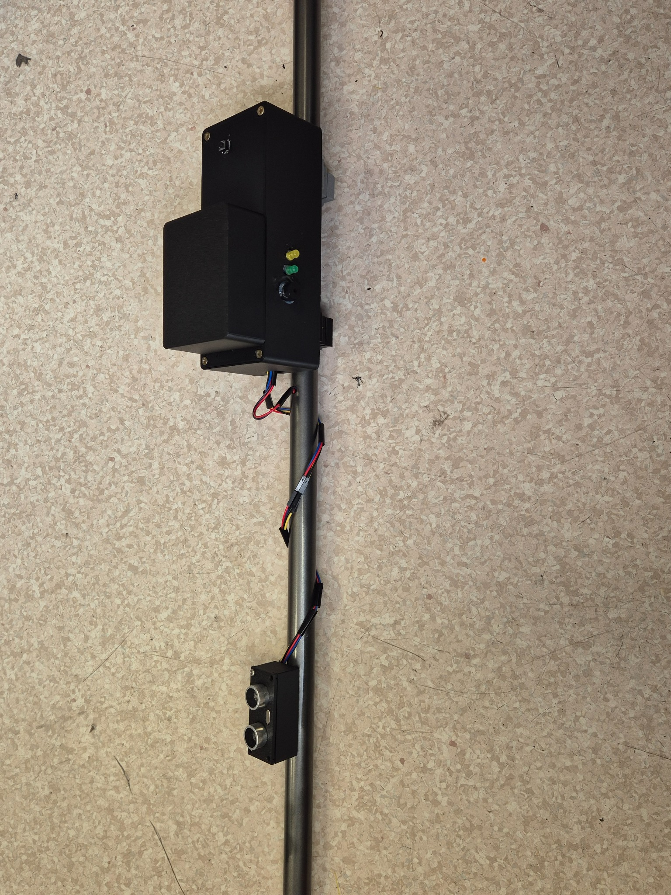
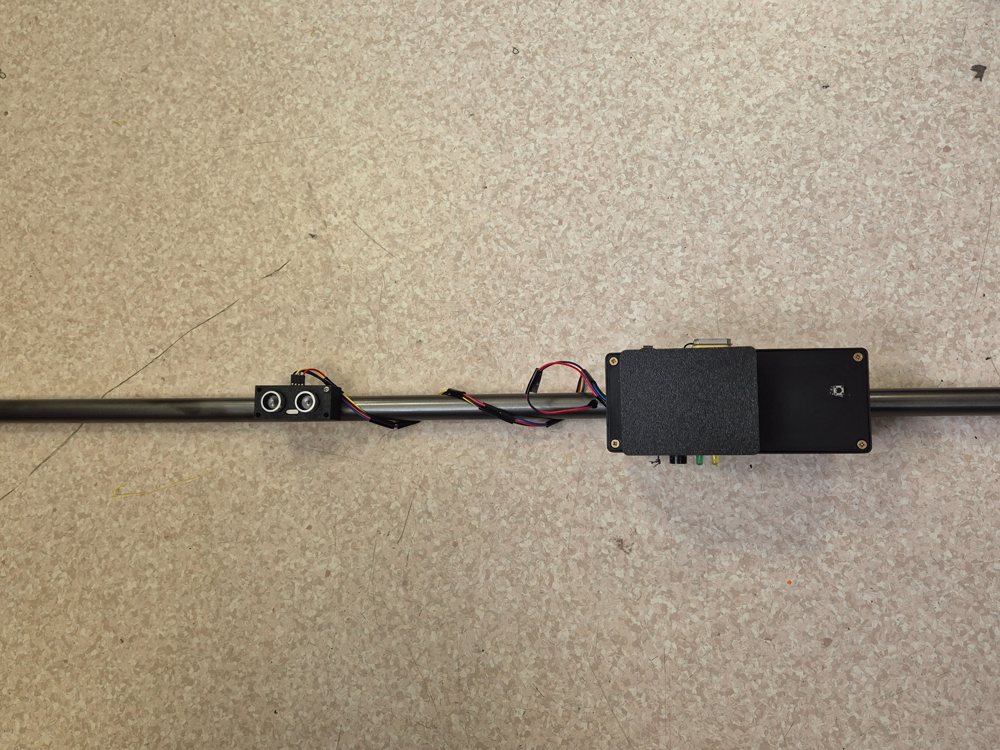
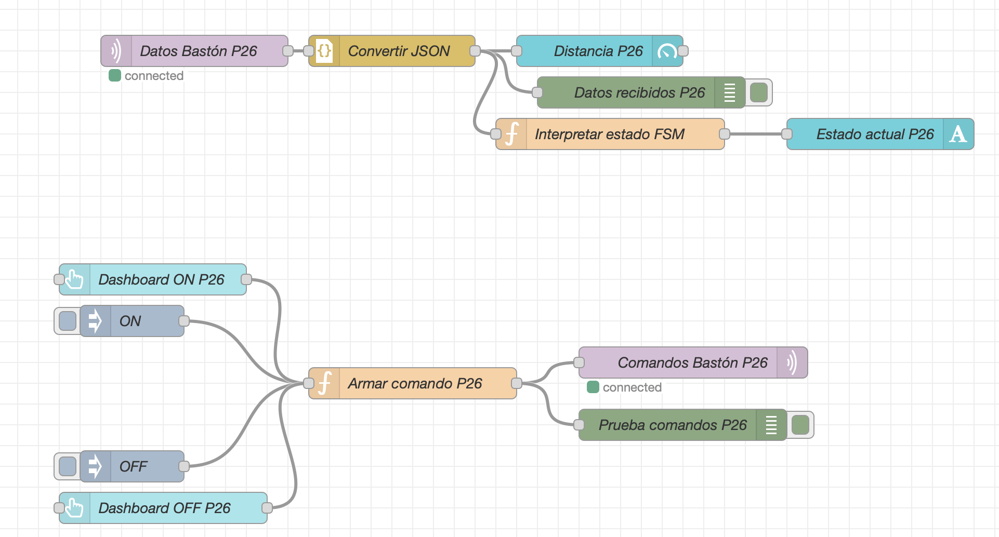
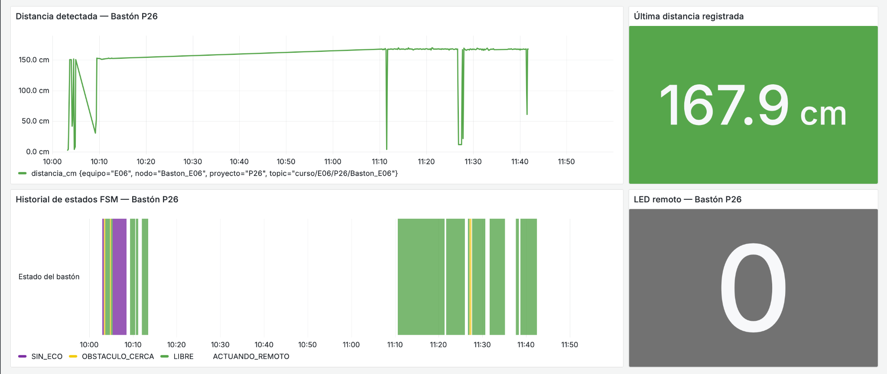

# P26 — Bastón Inteligente | Equipo E06

**Proyecto de Fundamentos de IoT — Universidad Autónoma de Chile.** Prototipo académico de asistencia que utiliza ESP32 y HC-SR04 para detectar obstáculos, activar avisos locales y transmitir datos mediante MQTT. Incorpora control remoto desde Node-RED, almacenamiento en InfluxDB, visualización en Grafana y módulo GPS.

> **Versión de referencia:** [`Entrega_Final/demo_P26_GT6_ERROR_BOTON_3S_GPIO22.ino`](Entrega_Final/demo_P26_GT6_ERROR_BOTON_3S_GPIO22.ino). Los archivos de `GT_1` a `GT_6` documentan etapas anteriores del desarrollo, no el firmware definitivo.

## Prototipo físico

**Vista general del montaje**

**Disposición del sensor HC-SR04 y la caja de control**

## Arquitectura IoT

El **ESP32** recibe las mediciones del **HC-SR04** y ejecuta una máquina de estados finitos (FSM) de seis estados. Según la distancia y las condiciones del sistema, controla el LED de advertencia, el buzzer y el motor de vibración. El módulo GPS incorpora posicionamiento. La telemetría se transmite por **MQTT** para supervisión desde **Node-RED**, almacenamiento en **InfluxDB** y consulta en **Grafana**.

El control remoto desde Node-RED permite encender o apagar el **LED amarillo conectado a GPIO22**, siempre sujeto a las condiciones de prioridad y seguridad programadas en la FSM.

### Estados de funcionamiento

| `estado_num` | Estado | Función |
| ---: | --- | --- |
| 0 | `LIBRE` | Medición válida, sin aviso de obstáculo prioritario |
| 1 | `OBSTACULO_LEJOS` | Aviso de obstáculo a distancia intermedia |
| 2 | `OBSTACULO_CERCA` | Aviso prioritario de obstáculo próximo |
| 3 | `ERROR_SENSOR` | Estado de error con bloqueo y rearme controlado |
| 4 | `ACTUANDO_REMOTO` | LED remoto activo mediante comando MQTT autorizado |
| 5 | `SIN_ECO` | No hay lectura ultrasónica confiable; no se supone automáticamente una avería |

**Histéresis:** CERCA utiliza los límites 20/25 cm y LEJOS los límites 50/60 cm para reducir oscilaciones de estado. La pérdida persistente de eco conduce a `SIN_ECO`. Una condición de ECHO alto persistente está contemplada como posible falla en el firmware.

### Diagnóstico y rearme mediante GPIO14

- **Pulsación larga de 3 segundos**, con lectura válida: activa una **simulación diagnóstica** de `ERROR_SENSOR`.
- El estado `ERROR_SENSOR` permanece bloqueado aunque se vuelvan a obtener mediciones válidas.
- Tras **tres ecos válidos consecutivos**, una **nueva pulsación corta** de GPIO14 permite el rearme hacia `LIBRE`, `OBSTACULO_LEJOS` o `OBSTACULO_CERCA`, según la distancia.
- La pulsación larga que activó la prueba **no** realiza el rearme por sí sola.

**Distinción técnica:** esta simulación permite validar el comportamiento de la FSM y el botón físico. **No equivale a haber demostrado una desconexión eléctrica detectada automáticamente**; esa prueba específica permanece pendiente.

## Hardware y conexiones

| Señal / componente | GPIO ESP32 |
| --- | ---: |
| HC-SR04 — TRIG | 26 |
| HC-SR04 — ECHO | 25 |
| LED principal de advertencia | 27 |
| Buzzer | 32 |
| Motor de vibración (salida a etapa de potencia) | 33 |
| Botón de diagnóstico y rearme | 14 |
| **LED amarillo remoto** | **22** |
| GPS UART2 RX / TX | 16 / 17 |

La señal ECHO del HC-SR04 utiliza adaptación de nivel hacia el ESP32. El motor se controla mediante una etapa de potencia; no se conecta directamente al GPIO. En la versión final se conserva el control digital del motor, **no PWM experimental**.

## Plataforma IoT y evidencias

### Node-RED

Recepción y visualización de datos MQTT, interpretación de los estados de la FSM y botones para el control remoto.

[Descargar configuración final de Node-RED](Entrega_Final/flujo_P26_final.json)

### Grafana

Dashboard con **cuatro paneles**: distancia detectada, última distancia registrada, historial de estados FSM e indicador de LED remoto.

[Descargar dashboard final de Grafana](Entrega_Final/dashboard_P26_final.json)

### Tópicos MQTT

| Uso | Tópico |
| --- | --- |
| Telemetría | `curso/E06/P26/Baston_E06` |
| Comandos | `curso/E06/P26/Baston_E06/cmd` |

Comandos para el LED remoto: `{"cmd":"ON"}` y `{"cmd":"OFF"}`. El firmware también contempla `{"comando":"reset"}` para el rearme de `ERROR_SENSOR` en las condiciones programadas.

## Resultados y validaciones

| Función | Estado |
| --- | --- |
| Detección de obstáculos: LIBRE, LEJOS y CERCA | **Validada** |
| Estado SIN_ECO | **Validado** |
| Diagnóstico simulado de ERROR_SENSOR mediante GPIO14 | **Validado** |
| Rearme mediante GPIO14 hacia los tres estados de distancia | **Validado** |
| LED amarillo remoto GPIO22 mediante Node-RED | **Validado** |
| Comunicación MQTT | **Validada** |
| Node-RED y Grafana | **Validados** |
| GPS | **Validado** |
| Detección física automática de una avería eléctrica real | **Pendiente de validación** |

- [Informe de validaciones (PDF)](Entrega_Final/Informe_Validaciones_P26_E06.pdf)
- [Matriz de validaciones](Entrega_Final/VALIDACIONES.md)
- [Grafo FSM de seis estados](Entrega_Final/Grafo_FSM_P26_6_Estados.pdf)

## Entrega final y organización del repositorio

| Ruta | Contenido |
| --- | --- |
| [`Entrega_Final/`](Entrega_Final/) | Firmware final, JSON actuales, informe, matriz y fotografías |
| [`GT_1/`](GT_1/) | Material de la primera etapa |
| [`GT_2/`](GT_2/) | Ensayos y grafo inicial |
| [`GT_3/`](GT_3/) | Informe técnico y FSM inicial |
| [`GT_4/`](GT_4/) | Desarrollo de conectividad MQTT |
| [`GT_5/`](GT_5/) | Integración de datos y consultas |
| [`GT_6/`](GT_6/) | Entrega histórica de integración IoT |

Los documentos y códigos de GT1–GT6 se conservan para mostrar la evolución del proyecto. **Para reproducir la versión actual debe utilizarse el `.ino` identificado como firmware final**, no el experimental anterior.

## Compilación y configuración

1. Abrir [`demo_P26_GT6_ERROR_BOTON_3S_GPIO22.ino`](Entrega_Final/demo_P26_GT6_ERROR_BOTON_3S_GPIO22.ino) en **Arduino IDE** con placa **ESP32 Dev Module**.
2. Copiar [`config.example.h`](Entrega_Final/config.example.h) como `config.h` **en la misma carpeta local del sketch**, y completar los datos de Wi-Fi y MQTT.
3. Contar con las bibliotecas `PubSubClient`, `ArduinoJson` y `TinyGPSPlus`, además del núcleo ESP32.
4. Compilar y cargar. Durante las pruebas se utilizó **115200 baudios** para carga y Monitor Serie.
5. Al importar las configuraciones de Node-RED y Grafana en otro entorno, ajustar conexiones MQTT y fuentes de datos.

**Seguridad:** nunca subir a GitHub el archivo privado `config.h`, contraseñas, tokens ni claves.

## Alcance

Este sistema es un **prototipo académico** y no constituye un dispositivo certificado de movilidad ni reemplaza otras ayudas de desplazamiento. Su desempeño depende, entre otros factores, de la geometría, reflectancia y cobertura del sensor ultrasónico.
